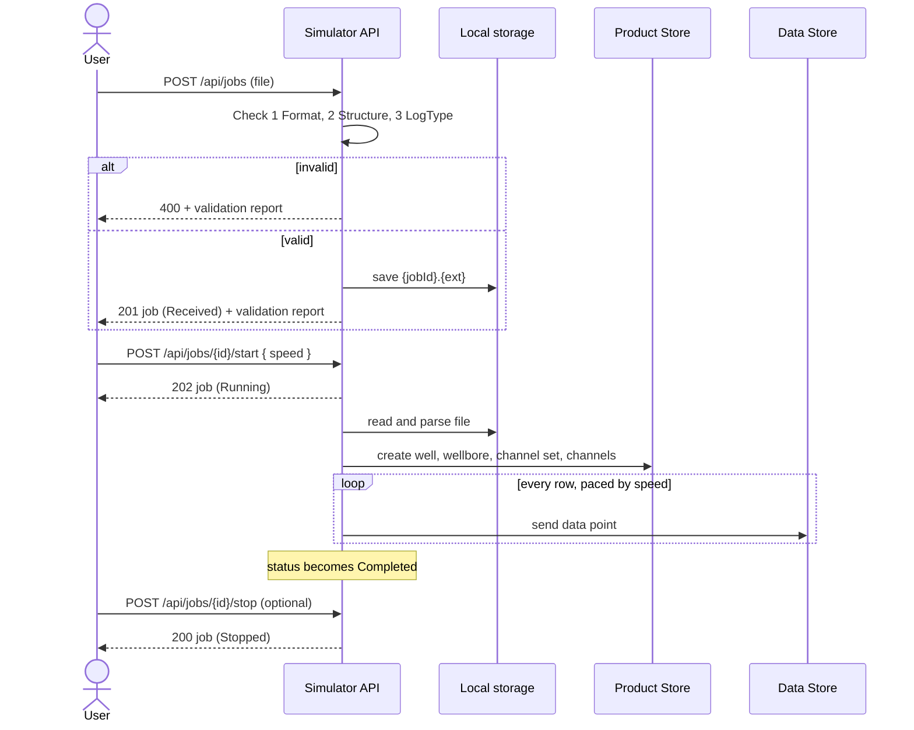
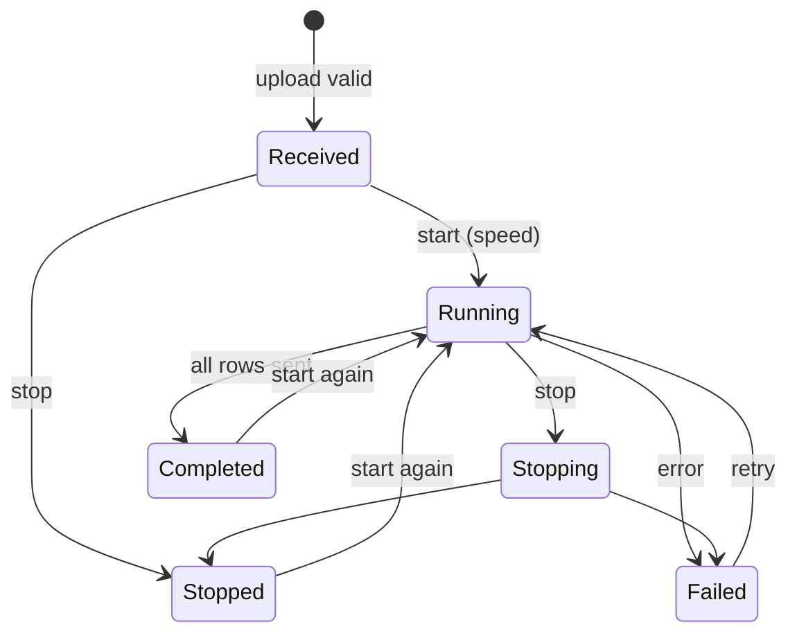

# Simulator API (.NET 10)

The Simulator replays a well-log file as if it were live data. A user uploads a **CSV**, **LAS** or **WITSML** file. The file is validated and stored. The user then picks a speed (1x, 2x, 5x or 10x). The simulator inserts the **header information into the Product Store** microservice and streams the **data rows into the Data Store** at the chosen speed.

---

## 1. Requirement

| # | Requirement | How it is met |
|---|---|---|
| 1 | The user uploads a file that can be CSV, WITSML or LAS. | `POST /api/jobs` takes a single field: the file. |
| 2 | Validate that the file is one of the three formats. | **Format** check: the extension must be supported **and** the content must match it. |
| 3 | Validate that the file is properly formed (e.g. a correct WITSML). | **Structure** check, with format-specific rules (section 6). |
| 4 | Validate whether it is a depth log or a time log. | **LogType** check: detects time/depth and validates the index values. |
| 5 | Store the file in local storage. | Saved to `App_Data/jobs/{jobId}.{ext}` once all checks pass. |
| 6 | After upload, the user selects the speed: 1x, 2x, 5x, 10x. | `POST /api/jobs/{id}/start` with `{ "speed": 1 \| 2 \| 5 \| 10 }`. |
| 7 | Parse the data and insert the header into the Product Store. | Well → Wellbore → Channel set (log) → Channels are created when the job starts. |
| 8 | Insert the data into the Data Store at the chosen frequency. | Rows are sent one by one, paced by the speed (section 8). |

---

## 2. Flow



---

## 3. Run

```bash
cd Simulator/Simulator.Api
dotnet run
```

- Swagger: `https://localhost:7180/swagger`
- Health: `GET /health`
- Every `/api/jobs` call needs a JWT. Locally, get one from `POST /dev/token` (section 12).
- Ready-made requests: `Simulator.Api.http` (Visual Studio / VS Code REST Client)
- Test files: `samples/valid` and `samples/invalid`

In **Development**, `Simulation:UseSimulatedStores` is `true`, so Product Store and Data Store calls are only written to the log. That lets you test without the real services. Set it to `false` and fill in `ProductStore` / `DataStore` in `appsettings.json` to call the real services.

---

## 4. Project structure

```
Simulator/
├── Simulator.slnx
├── README.md
└── Simulator.Api/
    ├── Program.cs                          App setup (controllers, Swagger, upload limits, errors)
    ├── appsettings.json                    Settings (section 11)
    ├── Simulator.Api.http                  Sample requests
    ├── Configuration/                      Settings classes (JobStorage, Simulation, Jwt, stores)
    ├── Controllers/
    │   └── JobsController.cs               All endpoints
    ├── Contracts/
    │   ├── JobContracts.cs                 Request/response models
    │   └── FileValidationContracts.cs      Validation report models
    ├── Validation/
    │   └── FileValidator.cs                Runs the 3 checks
    ├── Services/
    │   ├── Parsers/
    │   │   ├── FileFormatDetector.cs       Format by extension and by content
    │   │   ├── CsvLogParser.cs             CSV rules + parsing
    │   │   ├── LasLogParser.cs             LAS 1.2/2.0 rules + parsing
    │   │   ├── WitsmlLogParser.cs          WITSML 1.4.1 rules + parsing
    │   │   ├── ParsingHelpers.cs           Number/time parsing, index order checks
    │   │   ├── ParserContracts.cs          ParsedLog, ParseOutcome, DataPoint
    │   │   └── ParserResolver.cs           Picks the parser for a format
    │   ├── Storage/
    │   │   └── JobFileStorage.cs           Saves uploaded files to disk
    │   ├── Jobs/
    │   │   ├── JobService.cs               Register / start / stop
    │   │   ├── JobExecutor.cs              Header to Product Store, rows to Data Store
    │   │   ├── JobRunner.cs                Background execution + cancellation
    │   │   ├── JobStateMachine.cs          Allowed status changes
    │   │   ├── JobRepository.cs            In-memory job list
    │   │   └── JobExceptions.cs            404 / 409 errors
    │   └── Stores/
    │       ├── StoreContracts.cs           Header records + client interfaces
    │       ├── ProductStoreClient.cs       HTTP client
    │       ├── DataStoreClient.cs          HTTP client
    │       └── SimulatedStoreClients.cs    Log-only fakes for local testing
    ├── Infrastructure/
    │   ├── ServiceCollectionExtensions.cs  Dependency injection
    │   ├── JwtAuthenticationExtensions.cs  JWT validation + /dev/token
    │   └── JobExceptionHandler.cs          Errors as ProblemDetails
    └── samples/
        ├── valid/                          6 good files
        └── invalid/                        13 broken files
```

---

## 5. API reference

| Method | Route | Body | Success | Errors |
|---|---|---|---|---|
| POST | `/api/jobs` | multipart: `File` | 201 job + report | 400 report |
| POST | `/api/jobs/validate` | multipart: `File` | 200 report (nothing stored) | 400 report |
| GET | `/api/jobs/options` | – | 200 speeds, limits, file types | – |
| GET | `/api/jobs` | – | 200 list of jobs | – |
| GET | `/api/jobs/{id}` | – | 200 job | 404 |
| POST | `/api/jobs/{id}/start` | JSON `{ "speed": 2, "loopCount": 1 }` | 202 job | 400, 404, 409 |
| POST | `/api/jobs/{id}/stop` | – | 200 job (202 if still stopping) | 404, 409 |
| GET | `/health` | – | 200 `Healthy` (no token needed) | – |
| POST | `/dev/token` | JSON `{ "subject", "roles", "scope", "expiresInMinutes" }` | 200 test token (Development only) | – |

All `/api/jobs` endpoints also return **401** without a valid JWT and **403** without the required role/scope.

### 5.1 Upload

Request (only the file):

```bash
curl -H "Authorization: Bearer $TOKEN" -F "File=@samples/valid/witsml_time_log.xml" https://localhost:7180/api/jobs
```

Response `201 Created` (shortened):

```json
{
  "job": {
    "id": "3f2c...",
    "status": "Received",
    "fileName": "witsml_time_log.xml",
    "format": "Witsml",
    "formatVersion": "1.4.1.1",
    "logType": "Time",
    "indexMnemonic": "TIME",
    "indexUnit": "s",
    "startIndex": "2026-01-01T00:00:00.0000000+00:00",
    "endIndex": "2026-01-01T00:02:25.0000000+00:00",
    "wellName": "Well-B2",
    "wellboreName": "Wellbore-B2-ST1",
    "logName": "Realtime Drilling",
    "totalRows": 30,
    "channelCount": 2,
    "speed": null
  },
  "validation": {
    "fileName": "witsml_time_log.xml",
    "isValid": true,
    "format": "Witsml",
    "formatVersion": "1.4.1.1",
    "logType": "Time",
    "checks": [
      { "name": "Format",    "status": "Passed", "messages": ["WITSML file."] },
      { "name": "Structure", "status": "Passed", "messages": ["Valid WITSML 1.4.1.1 structure."] },
      { "name": "LogType",   "status": "Passed", "messages": ["Time log indexed by 'TIME' (s)."] }
    ],
    "warnings": [],
    "summary": {
      "indexMnemonic": "TIME",
      "indexUnit": "s",
      "rowCount": 30,
      "channels": [
        { "mnemonic": "ROP",  "unit": "m/h",  "description": "ROP curve" },
        { "mnemonic": "HKLD", "unit": "klbf", "description": "HKLD curve" }
      ]
    }
  }
}
```

Response `400 Bad Request` (a broken WITSML file). Every problem is listed at once:

```json
{
  "fileName": "witsml_broken_structure.xml",
  "isValid": false,
  "format": "Witsml",
  "checks": [
    { "name": "Format", "status": "Passed", "messages": ["WITSML file."] },
    { "name": "Structure", "status": "Failed", "messages": [
        "<log> is missing the required <nameWellbore> element.",
        "'RHOB' is in <mnemonicList> but has no <logCurveInfo>.",
        "<indexCurve> is 'DEPTH' but the first entry of <mnemonicList> is 'MD'. The index curve must come first.",
        "<unitList> has 2 entries but <mnemonicList> has 3.",
        "<data> row 2 (line 15): expected 3 values but found 2.",
        "<data> row 3 (line 16), curve 'RHOB': 'abc' is not a number."
    ]},
    { "name": "LogType", "status": "Passed", "messages": ["Depth log."] }
  ],
  "warnings": [],
  "summary": null
}
```

### 5.2 Options (for the UI speed picker)

```json
{ "speeds": [1, 2, 5, 10], "maxLoopCount": 100, "maxFileSizeMb": 100, "fileTypes": [".csv", ".las", ".xml", ".witsml"] }
```

### 5.3 Start with the chosen speed

```bash
curl -X POST -H "Authorization: Bearer $TOKEN" -H "Content-Type: application/json" -d '{ "speed": 10 }' https://localhost:7180/api/jobs/{id}/start
```

- `speed` is **required**: 1, 2, 5 or 10.
- `loopCount` is optional (default 1). It sets how many times to replay the file.
- The response is `202 Accepted` with the job in `Running`. Poll `GET /api/jobs/{id}` for `rowsSent` and `progressPercent`.

Speed errors (`400`):

```json
{ "errors": { "Speed": ["Speed 3 is not allowed. Choose 1 (1x), 2 (2x), 5 (5x), 10 (10x)."] } }
```

### 5.4 Stop

| Job status | Result |
|---|---|
| Running | Cancelled → `Stopped`, **200** (202 if still `Stopping` after `StopWaitTimeoutSeconds`) |
| Stopping | Waits, then **200** / 202 |
| Received | `Stopped` straight away, **200** |
| Stopped | Returned unchanged, **200** |
| Completed / Failed | **409 Conflict**. There is nothing to stop. |

### 5.5 Errors

404 and 409 errors are returned as ProblemDetails:

```json
{
  "status": 409,
  "title": "Action not allowed in the job's current status",
  "detail": "Job has already completed, so there is nothing to stop.",
  "jobId": "3f2c...",
  "currentStatus": "Completed"
}
```

---

## 6. Upload validation

The checks run in order. If a check fails, the later checks are shown as `Skipped`. A file is stored only when all three pass.

### Check 1: Format

| Rule | Example message |
|---|---|
| A file must be uploaded and must not be empty. | `The uploaded file is empty.` |
| The size must be within `MaxFileSizeMb`. | `The file is 120 MB; the limit is 100 MB.` |
| The extension must be `.csv`, `.las`, `.xml` or `.witsml`. | `'.txt' files are not supported. Upload a CSV (.csv), LAS (.las) or WITSML (.xml, .witsml) file.` |
| The content must match the extension (the first 4 KB is inspected). | `The file has a .csv extension (CSV) but its content looks like LAS.` |
| The content must be readable text, not binary. | `The file has a .las extension but its content is not a readable LAS file.` |

### Check 2: Structure

**CSV**

- The first non-empty line is the header. The delimiter is `,` `;` or tab, detected from the header.
- The header needs at least 2 columns (index + data). Column names must not be empty or repeated.
- Units can be in the header, like `ROP (m/h)` or `ROP [m/h]`, or in an optional second row of units.
- Every row must have the same number of values as the header.
- Data values must be numbers. An empty cell means "no value".
- The file must have at least one data row.

**LAS** (versions 1.2 and 2.0; 3.0 is rejected)

- Sections `~V`, `~W`, `~C` and `~A` are required. `~V` must come first and `~A` must come last.
- `~V` must contain `VERS` (1.2 or 2.0) and `WRAP` (`YES` or `NO`).
- Header lines must look like `MNEM.UNIT  VALUE : DESCRIPTION`.
- `~C` must list the index curve plus at least one data curve, with no duplicates.
- With `WRAP NO`, every `~A` line has exactly one value per curve. With `WRAP YES`, the total number of values must be a multiple of the curve count.
- All `~A` values must be numbers. Values equal to `NULL` are skipped.
- Missing `STRT` / `STOP` / `STEP` / `NULL` → warning. If `STRT` / `STOP` differs from the data → warning.

**WITSML** (1.4.1.x and 1.3.1.x; 2.x is rejected)

- The XML must be well-formed. DTDs are blocked for security.
- The root is `<logs>` in namespace `http://www.witsml.org/schemas/1series`.
- The file has exactly one `<log>`.
- Required in `<log>`: `nameWell`, `nameWellbore`, `name`, `indexType`, `indexCurve`, `logCurveInfo`, `logData`.
- Required in `<logData>`: `mnemonicList` and at least one `<data>` row.
- `indexCurve` must be the first entry in `mnemonicList`.
- Every mnemonic needs a `<logCurveInfo>`. There must be no duplicate mnemonics.
- `unitList` (if present) must have the same number of entries as `mnemonicList`.
- Each `<data>` row has one value per mnemonic, using `<dataDelimiter>` if one is given (default `,`).
- Values must be numbers. Empty values and `nullValue` are skipped.
- Curves with `typeLogData` of `string` or `date time` are skipped with a warning.
- Missing `uidWell` / `uidWellbore` / `uid` or `version` → warning. If `startIndex` / `endIndex` (or the date-time versions) differs from the data → warning.

### Check 3: LogType

| Format | Time log when… | Depth log when… |
|---|---|---|
| CSV | The index column is named like `Time`, `DateTime`, `Timestamp`, or contains "time". | The index column is named like `Depth`, `DEPT`, `MD`, `TVD`, or contains "depth". |
| LAS | The first curve is `TIME` / `ETIM`, or its unit is `s` / `ms`. | The first curve is `DEPT` / `DEPTH` / `MD` / `TVD`, or its unit is `m` / `ft`. |
| WITSML | `<indexType>` is `date time` or `elapsed time`. | `<indexType>` is `measured depth`, `true vertical depth`, `vertical depth` or `length`. |

For CSV, a first column that is an index column wins. Otherwise a time column is preferred over a depth column.

The index values are then checked:

- **Time:** every value must be a date/time (ISO 8601 recommended) or a number of elapsed seconds (or `ms`, `min`, `h` from the unit). Time must **increase**.
- **Depth:** every value must be a number. Depth must keep going **one way**, either always increasing or always decreasing.
- Repeated index values → warning.

---

## 7. Header information (Product Store)

### Where the names come from

The upload has no fields, so names are taken from the file. Anything missing falls back to the file name, and the upload response includes a warning saying so.

| File | Well | Wellbore | Log |
|---|---|---|---|
| WITSML | `<nameWell>` | `<nameWellbore>` | `<name>` |
| LAS | `WELL` in `~W` | same as the well | file name |
| CSV | file name | file name | file name |

### What is sent (when the job starts)

| Order | Call | Payload |
|---|---|---|
| 1 | `POST api/wells` | `name`, `uid` |
| 2 | `POST api/wells/{wellId}/wellbores` | `name`, `uid` |
| 3 | `POST api/wellbores/{wellboreId}/channelSets` | `name`, `uid`, `indexType` (Time/Depth), `indexMnemonic`, `indexUnit`, `startIndex`, `endIndex`, `sourceFormat`, `sourceFileName` |
| 4 | `POST api/channelSets/{channelSetId}/channels` | `mnemonic`, `unit`, `description`. One call per data curve. |

Each call must return `{ "id": "..." }`. The ids are saved on the job. If the job is started again, the same well, wellbore and channel set are reused.

`uid` values come from WITSML (`uidWell`, `uidWellbore`, `uid`) and from LAS (`UWI`). Null fields are not sent.

---

## 8. Data (Data Store) and speed

Each row is one call:

```http
POST api/data/points
```

```json
{
  "channelSetId": "1d5a4772...",
  "time": "2026-01-01T00:00:05+00:00",
  "depth": 1000.5,
  "values": { "ROP": 21, "HKLD": 181 }
}
```

### How the speed sets the frequency

| Log type | Wait between two rows |
|---|---|
| **Time** | The real time gap between the two rows ÷ speed. This is capped at `MaxRowDelayMs`. |
| **Depth** | `DepthRowIntervalMs` ÷ speed (default 1000 ms, so 1 row per second at 1x). |

Examples:

| File | 1x | 2x | 5x | 10x |
|---|---|---|---|---|
| Time log, rows 5 s apart | every 5 s | every 2.5 s | every 1 s | every 0.5 s |
| Depth log | every 1 s | every 0.5 s | every 0.2 s | every 0.1 s |

The speed is chosen per run. A stopped or completed job can be started again at a different speed.

---

## 9. Job status



Each change is recorded in the job's `history` with a time and a reason, for example `Received -> Running | Start requested at 10x`.

When the app shuts down, running jobs are cancelled and marked `Stopped`.

---

## 10. Storage

- Files are saved to `JobStorage:StoragePath` (default `App_Data/jobs`, relative to the project) as `{jobId}.{ext}`.
- The user's file name is never used in the path, so it cannot be used for path traversal.
- Only files that pass all three checks are saved.
- Jobs are kept **in memory** and are lost on restart. Files are **not deleted** automatically.
- `App_Data/` is in `.gitignore`.

---

## 11. Settings (`appsettings.json`)

| Key | Default | Meaning |
|---|---|---|
| `JobStorage:StoragePath` | `App_Data/jobs` | Where files are saved. Can be an absolute path, e.g. `D:\\SimulatorFiles`. |
| `JobStorage:MaxFileSizeMb` | `100` | Upload size limit |
| `Simulation:AllowedSpeeds` | `[1, 2, 5, 10]` | Speeds the user can choose |
| `Simulation:DepthRowIntervalMs` | `1000` | Time between depth rows at 1x |
| `Simulation:MaxRowDelayMs` | `60000` | Longest wait between two time rows |
| `Simulation:MaxLoopCount` | `100` | Highest `loopCount` allowed |
| `Simulation:StopWaitTimeoutSeconds` | `10` | How long stop waits for the job to end |
| `Simulation:UseSimulatedStores` | `false` (`true` in Development) | Log store calls instead of sending them |
| `ProductStore:BaseUrl` / `ApiKey` / `TimeoutSeconds` | – | Product Store connection. The key is sent as `X-Api-Key`. |
| `DataStore:BaseUrl` / `ApiKey` / `TimeoutSeconds` | – | Data Store connection. The key is sent as `X-Api-Key`. |
| `Jwt:*` | – | Token validation (section 12) |

---

## 12. Authentication (JWT)

All `/api/jobs` endpoints need a valid JWT in the `Authorization` header:

```http
Authorization: Bearer eyJhbGciOi...
```

`/health` stays open. Without a valid token the API returns **401**. A valid token that lacks the required role or scope returns **403**.

### What is checked

| Check | Rejected when |
|---|---|
| Signature | The token was not signed by your identity provider / key, or it is unsigned (`alg: none`) |
| Issuer (`iss`) | It is from a different issuer |
| Audience (`aud`) | It was issued for a different API |
| Lifetime (`exp`, `nbf`) | It is expired or not valid yet (30 s clock skew allowed) |
| Role / scope (optional) | `Jwt:RequiredRole` / `Jwt:RequiredScope` is set and the token doesn't have it → 403 |

Rejected tokens are logged as `Rejected token: <reason>`. The `WWW-Authenticate` response header also gives the reason.

### Choose one mode in `appsettings.json`

**A. Identity provider** (Azure AD/Entra ID, Keycloak, Duende IdentityServer, Auth0). Signing keys are downloaded and rotated automatically.

```json
"Jwt": {
  "Enabled": true,
  "Authority": "https://login.microsoftonline.com/<tenant-id>/v2.0",
  "Audience": "api://<simulator-api-client-id>",
  "RequiredRole": "",
  "RequiredScope": ""
}
```

| Provider | Authority | Audience |
|---|---|---|
| Entra ID (v2 tokens) | `https://login.microsoftonline.com/<tenant-id>/v2.0` | The API's Application ID URI or client id |
| Keycloak | `https://<host>/realms/<realm>` | The client id (add an audience mapper) |
| Duende / IdentityServer | `https://<identity-server>` | The API resource name |

> Entra ID v1 tokens have issuer `https://sts.windows.net/<tenant-id>/`. In that case also set `"Issuer"` to that value.

**B. Own signing key** (your own auth service signs tokens with HS256):

```json
"Jwt": {
  "Enabled": true,
  "Authority": "",
  "Issuer": "https://your-auth-service",
  "Audience": "simulator-api",
  "SigningKey": "<at least 32 characters - keep it in user secrets / env var / Key Vault>"
}
```

The app refuses to start if the settings are incomplete. For example, it stops when both or neither of Authority and SigningKey are set, the audience is missing, or the key is shorter than 32 characters.

### Local development

`appsettings.Development.json` uses mode B with a dev-only key and enables a helper endpoint to create test tokens:

```bash
curl -X POST https://localhost:7180/dev/token -H "Content-Type: application/json" \
     -d '{ "subject": "abhishek", "roles": ["simulator.operator"], "expiresInMinutes": 60 }'
```

Response: `{ "access_token": "eyJ...", "token_type": "Bearer", "expires_in": 3600 }`

In Swagger, click **Authorize** and paste the token without the word "Bearer". `POST /dev/token` exists **only** in the Development environment and only in mode B. In any other environment it returns 404.

To turn authentication off for a quick local test, set `"Jwt": { "Enabled": false }`. Never do this in a deployed environment.

### Code

| File | Purpose |
|---|---|
| `Configuration/JwtOptions.cs` | The `Jwt` settings |
| `Infrastructure/JwtAuthenticationExtensions.cs` | Token validation, role/scope policy, startup checks, `/dev/token` |
| `Program.cs` | `AddJwtValidation(...)`, `UseAuthentication()` before `UseAuthorization()`, Swagger Authorize button |
| `Controllers/JobsController.cs` | `[Authorize]` on the controller |

Package: `Microsoft.AspNetCore.Authentication.JwtBearer` 10.0.0.

---

## 13. Sample files

| File | Expected result |
|---|---|
| `valid/time_log.csv` | CSV, time log, 30 rows |
| `valid/depth_log.csv` | CSV with a units row, depth log, 25 rows |
| `valid/depth_log.las` | LAS 2.0, depth log, with a NULL value |
| `valid/time_log.las` | LAS 2.0, time log (elapsed seconds) |
| `valid/witsml_time_log.xml` | WITSML 1.4.1.1, `date time` index |
| `valid/witsml_depth_log.xml` | WITSML 1.4.1.1, `measured depth` index |
| `invalid/notes.txt` | Format fails: unsupported type |
| `invalid/las_saved_as.csv` | Format fails: LAS content with a .csv extension |
| `invalid/witsml_not_well_formed.xml` | Structure fails: bad XML |
| `invalid/witsml_wrong_namespace.xml` | Structure fails: wrong namespace |
| `invalid/witsml_broken_structure.xml` | Structure fails: 6 problems listed |
| `invalid/las_version_3.las` | Structure fails: LAS 3.0 |
| `invalid/las_missing_sections.las` | Structure fails: missing ~W, ~C, WRAP |
| `invalid/las_bad_rows.las` | Structure fails: wrong value count, non-number |
| `invalid/csv_bad_values.csv` | Structure + LogType fail |
| `invalid/csv_no_index_column.csv` | LogType fails: no time/depth column |
| `invalid/csv_depth_changes_direction.csv` | LogType fails: depth reverses |
| `invalid/witsml_time_goes_backwards.xml` | LogType fails: time goes back |
| `invalid/witsml_unknown_index_type.xml` | LogType fails: indexType `other` |

---

## 14. Assumptions and open questions

| # | Question | Current assumption |
|---|---|---|
| 1 | What exact request does the Product Store API expect? | Separate calls for well → wellbore → channel set → channel (from the original DataSimulator code), with the header fields added. Only `ProductStoreClient.cs` changes if it differs. |
| 2 | Should the Data Store get one row per call, or batches? | One row per call, to match the chosen frequency. |
| 3 | What does "1x" mean for a depth log? | 1 row per second (`DepthRowIntervalMs`). |
| 4 | Where do the names come from for CSV, which has no header? | The file name, with a warning. Renaming could later be added to the start request. |
| 5 | Is WITSML 2.0, or validation against the official XSD files, needed? | 1.4.1 / 1.3.1 only. The schema rules are checked in code, without loading the XSDs. |
| 6 | Should an existing well/wellbore in the Product Store be reused? | A new one is always created. Re-running the same job reuses its own ids. |
| 7 | Is a cap on long time gaps acceptable? | Yes. Any single wait is capped at 60 s. |
| 8 | Must jobs and files survive restarts, or be cleaned up? | Jobs are in memory. Files are kept forever. |
